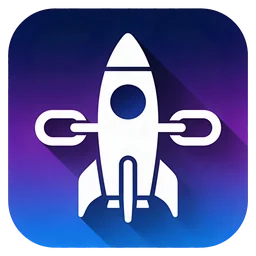
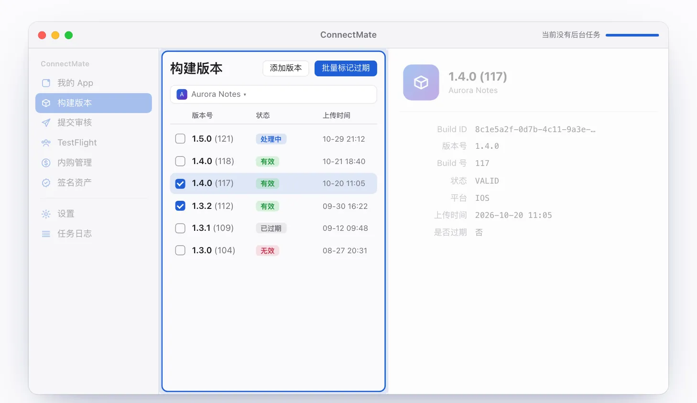
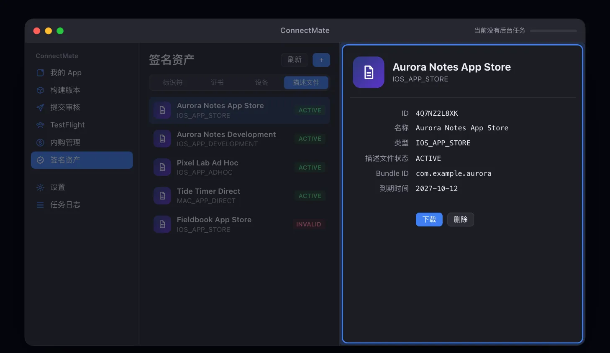
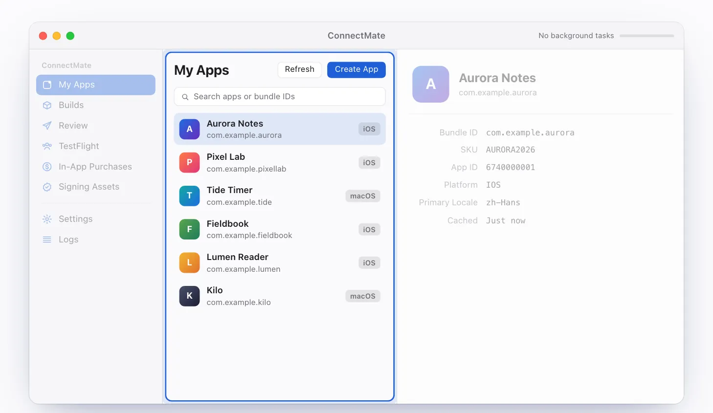

  

<h1 align="center">ConnectMate</h1>

  原生 macOS 的 App Store Connect 管理工具 · <a href="https://connectmate.vanjay.cn">主页</a> · <a href="https://github.com/wangwanjie/ConnectMate/releases/latest">下载</a> · <a href="#english">English</a>

ConnectMate 通过本机的 [asc CLI](https://github.com/rudrankriyam/App-Store-Connect-CLI) 管理 App Store Connect。左侧导航、中间列表、右侧详情的三栏窗口里，可以完成 API Key 配置、App 查看与创建、构建版本批量处理和签名资产管理，每条命令都会写入本地日志。

界面示意，图中 App 与数据均为虚构示例。

## 功能

- **API Key**：填写 Issuer ID、Key ID，拖入 `.p8` 私钥后一键验证；可保存多套配置并切换当前账号。私钥以安全作用域书签引用，文件留在原处。
- **我的 App**：列表缓存在本地，按名称或 Bundle ID 搜索；详情显示 Bundle ID、SKU、App ID、平台；支持创建 App（使用 asc 的 Web Session 流程）。
- **构建版本**：按 App 加载，显示处理中 / 有效 / 无效 / 已过期状态；多选后批量标记过期；为 App 添加 App Store 版本。
- **签名资产**：标识符、证书、设备、描述文件。生成 CSR 并创建证书、用当前 Mac 的 UDID 注册设备、创建 / 下载 / 删除描述文件、配置标识符能力。
- **命令日志与导出**：每条 asc 命令连同参数、输出、退出码与耗时写入本地数据库；可导出命令日志，或把配置、缓存与日志一并导出为 JSON。
- **偏好设置**：简体中文 / 繁体中文 / 英文界面；跟随系统 / 浅色 / 深色；缓存有效期、全局快捷键、HTTP 代理、命令超时与重试次数。
- **自动更新**：内置 Sparkle，更新包经 EdDSA 签名校验。

## 下载与安装

1. 从 [Releases](https://github.com/wangwanjie/ConnectMate/releases/latest) 下载 DMG（当前版本 1.0：`ConnectMate_v1.0_1.dmg`，6.5 MB）。
2. 打开 DMG，把 ConnectMate 拖进「应用程序」文件夹。
3. 之后的新版本会在应用内通过 Sparkle 提示更新。

安装包为 Universal 版本（Apple 芯片与 Intel 均可运行），使用 Developer ID 签名并经 Apple 公证。

## 使用前准备

1. 按 [App Store Connect CLI](https://github.com/rudrankriyam/App-Store-Connect-CLI) 项目说明安装 asc。ConnectMate 默认使用 `/usr/local/bin/asc`，可在「设置 → CLI 与 API」中修改，首次启动会自动检查。
2. 在 App Store Connect 后台创建 API Key，记下 Issuer ID、Key ID，并下载 `.p8` 私钥。
3. 打开「管理 API Key」，拖入 `.p8`、填好信息后点击验证，再刷新「我的 App」。

## 系统要求

- macOS 13 或更高版本
- 已安装 asc CLI
- App Store Connect API Key

## 隐私

ConnectMate 没有账号系统，也不内置统计 SDK。API Key 配置、缓存与命令日志保存在本机 `~/Library/Application Support/ConnectMate`，对 App Store Connect 的访问全部经由本机的 asc CLI 完成。检查更新时，应用会向 GitHub 请求更新源与 Release 信息；Sparkle 可能随请求附带匿名系统信息（如 macOS 版本）。

## 反馈

问题与建议请提交到 [Issues](https://github.com/wangwanjie/ConnectMate/issues)。更多作品见 [vanjay.cn](https://vanjay.cn)。

---

## English

ConnectMate is a native macOS app that manages App Store Connect through your local [asc CLI](https://github.com/rudrankriyam/App-Store-Connect-CLI). In a three-pane window (sidebar, list, detail) you can set up API keys, browse and create apps, handle builds in batches and manage signing assets, while every command is logged locally.

Illustration only. Apps and data shown are fictional examples.

### Features

- **API keys**: enter the Issuer ID and Key ID, drop in the `.p8` key and validate. Save several profiles and switch the active account. The key is referenced through a security-scoped bookmark and stays where you keep it.
- **My Apps**: cached locally and searchable by name or bundle ID; the detail pane shows bundle ID, SKU, App ID and platform. Create apps via the asc web-session flow.
- **Builds**: load builds per app with processing / valid / invalid / expired status, expire several at once, and add a new App Store version.
- **Signing assets**: identifiers, certificates, devices and profiles. Generate a CSR and create a certificate, register this Mac by its UDID, create / download / delete profiles, configure identifier capabilities.
- **Command log and export**: every asc command is stored with arguments, output, exit code and duration. Export the command log, or export settings, cache and logs together as JSON.
- **Preferences**: Simplified Chinese / Traditional Chinese / English; match system / light / dark; cache lifetime, global shortcut, HTTP proxy, command timeout and retry count.
- **Updates**: built on Sparkle with EdDSA-signed updates.

### Download and install

1. Download the DMG from [Releases](https://github.com/wangwanjie/ConnectMate/releases/latest) (current version 1.0: `ConnectMate_v1.0_1.dmg`, 6.5 MB).
2. Open the DMG and drag ConnectMate into Applications.
3. Future versions are offered in the app through Sparkle.

The app is Universal (Apple silicon and Intel), signed with Developer ID and notarized by Apple.

### Before you start

1. Install asc by following the [App Store Connect CLI](https://github.com/rudrankriyam/App-Store-Connect-CLI) instructions. ConnectMate uses `/usr/local/bin/asc` by default; change it under Settings → CLI & API.
2. Create an API key in App Store Connect, note the Issuer ID and Key ID, and download the `.p8` key.
3. Open Manage API Keys, drop in the `.p8`, fill in the details and click Validate, then refresh My Apps.

### Requirements

- macOS 13 or later
- asc CLI installed
- An App Store Connect API key

### Privacy

ConnectMate has no accounts and no analytics SDK. API key profiles, cache and command logs stay on your Mac in `~/Library/Application Support/ConnectMate`, and all App Store Connect access goes through your local asc CLI. When checking for updates, the app requests the update feed and release information from GitHub; Sparkle may include anonymous system information such as the macOS version.

### Feedback

Please open an [issue](https://github.com/wangwanjie/ConnectMate/issues). More apps at [vanjay.cn](https://vanjay.cn).
